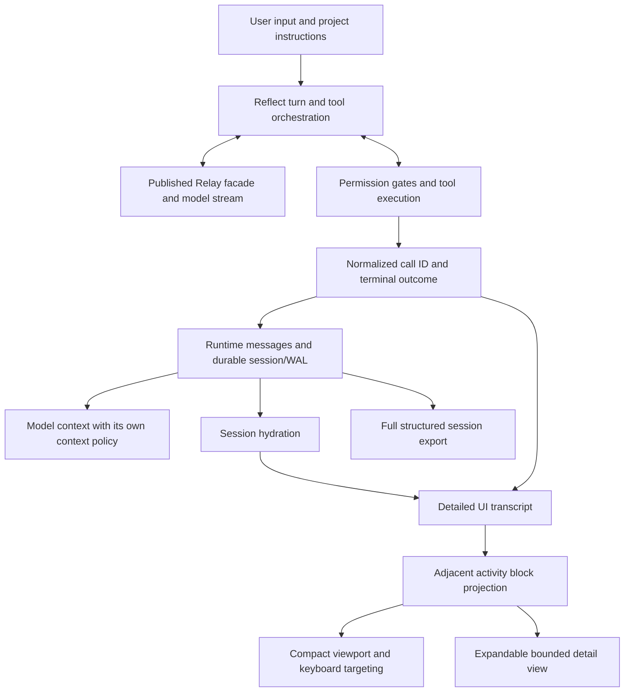

# Coding-agent data flows and Reflect's activity display

Reviewed 2026-11-04. This replaces the earlier tool-count comparison, whose
unsourced parity and superiority claims should not guide architecture decisions.

## Scope and method

This is a source review of 20 popular, non-archived open-source coding agents,
coding-capable general agents, and editor hosts, ordered by GitHub stars within
a reviewed set of 30 candidates. It is not an exhaustive worldwide ranking,
a coding-quality benchmark, or a claim that all 20 have equivalent capabilities.
Stars measure repository popularity, including an editor's other functionality.

Repository metadata, license information, default-branch commit IDs, recursive
file trees, and the implementation files linked below were read from GitHub.
Each implementation link pins the inspected commit. Star counts are a snapshot
and will change. Zed has licenses by component; GitHub's single license field
does not describe the complete project. Archived Roo Code/Void snapshots and
GPT Pilot's FSL source-available snapshot were excluded from the reviewed cohort.

The review traces the boundary between execution, model/history state, and
presentation. Some rows inspect only the client or execution boundary; they
explicitly say so. Related codebases (for example the Codex-family trees and
OpenCode-derived Kilo paths) should not be counted as independent validation.

## Inspected implementations

| # | Repository | Stars at review | License | Observed data flow and pinned evidence |
| --- | --- | ---: | --- | --- |
| 1 | [deepseek-ai/deepseek-harness](https://github.com/deepseek-ai/deepseek-harness) | 271,433 | MIT | Turn/step events append to a session; pending tool results are recovered after exceptions. The UI builds nested call-ID trees with separate inspection/disclosure. [execution](https://github.com/deepseek-ai/deepseek-harness/blob/8bd073392eef6f54e921a093b95076248eb08cbb/packages/core/agent-loop/src/agent.ts) · [presentation](https://github.com/deepseek-ai/deepseek-harness/blob/8bd073392eef6f54e921a093b95076248eb08cbb/packages/client/ui-tool/src/client/tool/ToolCallTree.tsx) |
| 2 | [NousResearch/hermes-agent](https://github.com/NousResearch/hermes-agent) | 260,297 | MIT | Call references carry identity through sequential/concurrent execution; result messages are appended and progress flushed. Quiet spinner completion is distinct from output-history rendering. [execution](https://github.com/NousResearch/hermes-agent/blob/aac7f1b6962906efd73fbf70beae8d374a52f504/agent/tool_executor.py) · [presentation](https://github.com/NousResearch/hermes-agent/blob/aac7f1b6962906efd73fbf70beae8d374a52f504/hermes_cli/cli_render.py) |
| 3 | [anomalyco/opencode](https://github.com/anomalyco/opencode) | 224,408 | MIT | A session coordinator drains queued input and publishes one terminal execution observation per busy period. Tool display uses explicit running/completed/error states and input summaries. [execution](https://github.com/anomalyco/opencode/blob/55276f2108c8853f94cf16dc530e7754a6ce8318/packages/core/src/session/execution.ts) · [presentation](https://github.com/anomalyco/opencode/blob/55276f2108c8853f94cf16dc530e7754a6ce8318/packages/tui/src/util/tool-display.ts) |
| 4 | [openai/codex](https://github.com/openai/codex) | 133,061 | Apache-2.0 | Executed-call metadata is recorded separately from dispatch and append-only rollout history. Adjacent activity groups retain ordered calls and separate detail cells. [execution](https://github.com/openai/codex/blob/d84c872464aca4821dc5cb548a651651aefd84fa/codex-rs/core/src/tools/executed_tool_calls.rs) · [presentation](https://github.com/openai/codex/blob/d84c872464aca4821dc5cb548a651651aefd84fa/codex-rs/tui/src/history_cell/activity_group.rs) |
| 5 | [earendil-works/pi](https://github.com/earendil-works/pi) | 119,885 | MIT | The reusable agent loop emits ordered lifecycle/message/tool events. Interactive tool components retain call IDs, partial arguments, results, and local expansion state. [execution](https://github.com/earendil-works/pi/blob/676af1d777ef6f04b6bc8daf4cf3b9b1799cff4d/packages/agent/src/agent-loop.ts) · [presentation](https://github.com/earendil-works/pi/blob/676af1d777ef6f04b6bc8daf4cf3b9b1799cff4d/packages/coding-agent/src/modes/interactive/components/tool-execution.ts) |
| 6 | [google-gemini/gemini-cli](https://github.com/google-gemini/gemini-cli) | 108,712 | Apache-2.0 | The scheduler executes tools with call identity and hooks. The CLI applies visibility rules and grouped/compact presentation independently of execution results. [execution](https://github.com/google-gemini/gemini-cli/blob/89e9d25d67e7dc7cb0deb84ad2c3474b7a392d31/packages/core/src/scheduler/tool-executor.ts) · [presentation](https://github.com/google-gemini/gemini-cli/blob/89e9d25d67e7dc7cb0deb84ad2c3474b7a392d31/packages/cli/src/ui/components/messages/ToolGroupMessage.tsx) |
| 7 | [zed-industries/zed](https://github.com/zed-industries/zed) | 92,642 | GPL/Apache components | Native thread events update an ACP thread, including tool-call updates and retry/compaction status. The editor consumes thread state rather than raw runtime print statements. [execution](https://github.com/zed-industries/zed/blob/dd3437011469d5c2ec8c821a84cc999979625697/crates/agent/src/agent.rs) |
| 8 | [OpenHands/OpenHands](https://github.com/OpenHands/OpenHands) | 92,603 | MIT | The client resolves action/observation events against full history. Consecutive agent steps become a collapsible summary with a live status and retained expanded event messages; this review covers the client boundary, not the external runtime SDK. [presentation](https://github.com/OpenHands/OpenHands/blob/01d1970b8f96d576d8b42aad48fee5aa117f1cb8/src/components/conversation-events/chat/event-message-components/event-group.tsx) |
| 9 | [cline/cline](https://github.com/cline/cline) | 71,278 | Apache-2.0 | The chat projection combines completed low-stakes tools with active reading/exploration, computes a group summary, and exposes selected details on demand. [presentation](https://github.com/cline/cline/blob/e68a6ddc2c7a7b4ced07a3ec5947cdb4af3af6e8/apps/vscode/webview-ui/src/components/chat/chat-view/components/messages/ToolGroupRenderer.tsx) |
| 10 | [openinterpreter/openinterpreter](https://github.com/openinterpreter/openinterpreter) | 68,790 | Apache-2.0 | The current tree defines tool execution/exposure separately from the TUI. Its adjacent activity groups retain ordered calls and detail cells. These shared-family patterns are not independent evidence of a universal design. [execution](https://github.com/openinterpreter/openinterpreter/blob/f12ce327eeee679d2f2f22ce23018b0db9ae092f/codex-rs/tools/src/tool_executor.rs) · [presentation](https://github.com/openinterpreter/openinterpreter/blob/f12ce327eeee679d2f2f22ce23018b0db9ae092f/codex-rs/tui/src/history_cell/activity_group.rs) |
| 11 | [FoundationAgents/OpenManus](https://github.com/FoundationAgents/OpenManus) | 58,867 | MIT | Think/act tool calls execute sequentially; observations enter memory with command IDs. The same path logs result bodies, demonstrating that a tool loop alone does not imply a quiet interface. [execution](https://github.com/FoundationAgents/OpenManus/blob/3309bf4e416fb1c74b008f3e86494439a31bad53/app/agent/toolcall.py) |
| 12 | [aaif-goose/goose](https://github.com/aaif-goose/goose) | 56,197 | Apache-2.0 | A state machine emits tool responses matched to request IDs, with permission/hook handling. The desktop maintains tool response views with explicit expansion state. [execution](https://github.com/aaif-goose/goose/blob/71dd9a9aa2344247a51bc349f4d0b97c2dbff4bd/crates/goose/src/agents/state_machine/ops_toolcalling.rs) · [presentation](https://github.com/aaif-goose/goose/blob/71dd9a9aa2344247a51bc349f4d0b97c2dbff4bd/ui/desktop/src/components/ToolCallWithResponse.tsx) |
| 13 | [Aider-AI/aider](https://github.com/Aider-AI/aider) | 49,932 | Apache-2.0 | Input is added to current messages, formatted into model context, and streamed through a separate IO renderer. Full model-message printing is conditional on verbose mode; the coding loop also owns edit application. [execution](https://github.com/Aider-AI/aider/blob/5dc9490bb35f9729ef2c95d00a19ccd30c26339c/aider/coders/base_coder.py) |
| 14 | [continuedev/continue](https://github.com/continuedev/continue) | 36,405 | Apache-2.0 | Preprocess calls, attach errors/results to assistant-owned tool states by call ID, then execute valid calls. Comments explicitly prohibit appending duplicate tool-result history entries. [execution](https://github.com/continuedev/continue/blob/5522c6f44ca0ac3528b37244818fbfa39b5af470/extensions/cli/src/stream/handleToolCalls.ts) |
| 15 | [QwenLM/qwen-code](https://github.com/QwenLM/qwen-code) | 28,987 | Apache-2.0 | The loop distinguishes executed/replayed/skipped/duplicate calls and provides host callbacks. The compact UI derives overall status, a tool summary, elapsed time, and an optional hint. [execution](https://github.com/QwenLM/qwen-code/blob/7d5a82443a69225727900c843db9e31296d3ad6b/packages/core/src/core/agent-loop.ts) · [presentation](https://github.com/QwenLM/qwen-code/blob/7d5a82443a69225727900c843db9e31296d3ad6b/packages/cli/src/ui/components/messages/CompactToolGroupDisplay.tsx) |
| 16 | [Kilo-Org/kilocode](https://github.com/Kilo-Org/kilocode) | 27,853 | MIT | Stream events create call-ID-keyed tool parts, then transition their persisted state on result/error. Result output and attachments are retained separately from presentation. [execution](https://github.com/Kilo-Org/kilocode/blob/080ca6c41399e014cfcc8657202863bb8e3ab6d6/packages/opencode/src/session/processor.ts) |
| 17 | [xai-org/grok-build](https://github.com/xai-org/grok-build) | 27,677 | Apache-2.0 | Execution blocks retain live/output details. Collapsed headers prefer a description and omit the command line; the expanded view can include it. [presentation](https://github.com/xai-org/grok-build/blob/2bdd1d6a6369de0e8c68132ea4539e9abd9e14a8/crates/codegen/xai-grok-pager/src/scrollback/blocks/tool/execute.rs) |
| 18 | [SWE-agent/SWE-agent](https://github.com/SWE-agent/SWE-agent) | 20,717 | MIT | The agent appends query/action/observation history through hooks and carries tool-call IDs into model history. This is a trajectory-oriented execution architecture, not evidence of a grouped terminal default. [execution](https://github.com/SWE-agent/SWE-agent/blob/3ea751c087f32b16e039a2233dd6eefecef325d5/sweagent/agent/agents.py) |
| 19 | [stackblitz-labs/bolt.diy](https://github.com/stackblitz-labs/bolt.diy) | 20,030 | MIT | Server planning/completion tools are distinct from browser project effects. Step results are matched by tool-call ID into message parts; loop progress controls active tools and completion guidance. [execution](https://github.com/stackblitz-labs/bolt.diy/blob/353b44c8f386aeb15abdf277515d78ff50f7578e/app/lib/.server/llm/agent-loop.ts) |
| 20 | [stitionai/devika](https://github.com/stitionai/devika) | 19,550 | MIT | A coordinator sequences planning, research, and coding. Project state stacks are persisted in SQLite and emitted over sockets; terminal/browser progress is represented as state fields rather than only log text. [execution](https://github.com/stitionai/devika/blob/80bb343cbe4a4e5f5a0ba08d2524920139baceb6/src/agents/agent.py) · [presentation](https://github.com/stitionai/devika/blob/80bb343cbe4a4e5f5a0ba08d2524920139baceb6/src/state.py) |

## What Reflect adopts

These are design conclusions from the sources, not claims that every project
implements the same architecture:

- Keep execution facts separate from their screen representation. A compact
  display must not truncate the model's observation or replace durable history.
- Join tool starts/results by call ID, preserve launch order under concurrent
  completion, and ignore replayed terminal observations within a user turn.
- Project adjacent tool activity into one summary. Offer deliberate inspection
  instead of automatically printing each command, result body, and truncation
  notice. OpenHands, Qwen, Cline, and the inspected activity-group structures
  provide concrete variations of this separation.
- Preserve explicit failed, cancelled, running, and incomplete states. Missing
  persisted results are not evidence that a tool succeeded.
- Keep permission, approval, credential, question, warning, user, and assistant
  messages outside tool groups.
- Restore tool identity and observed error status from structured session data.
  Use the same projection for terminal drawing, expansion, and code-copy targeting.

No implementation code was copied from these projects. This change applies the
principles in Reflect's host UI and session projection. Provider protocols remain
owned by the independently published Relay dependency.

## Reflect data flow



The summary is a view over existing transcript indices. It is not another model
message and is not written back into model history. The final activity block is
mutable as calls arrive; the render cache rebuilds that block rather than
appending another visible tool row. Non-tool message boundaries stay intact.

The default display is one row per adjacent activity group, for example:

```text
✓ Read 3 files · 2 searches · Ran 1 command · Tab, Enter: details
```

A failed group also shows a short diagnostic line. Tab focuses scrollback;
scroll to place the activity at the viewport center, then press Enter to
expand/collapse its commands and outputs. Large outputs retain the existing
bounded terminal detail view; full observations remain in the session/export.
Restored calls without results are labelled incomplete. Older unstructured
records cannot supply identity or error status that was never stored.
The published result contract retains an error flag; it does not preserve a
separate timeout/cancellation reason for the restored display.

The footer labels cumulative API input plus output as **session tokens**. The
connection row's **ctx** gauge describes the latest prompt (or a local estimate
before API usage is available). Reused system/project instructions contribute
to every request's input usage. The context percentage uses **<1%** for a
positive value below one percent instead of displaying a misleading zero.

## Validation

Regression coverage exercises a growing cached group versus a fresh render,
concurrent completion and failure, replayed events, IDs reused on later turns,
restored tool results and incomplete calls, interactive message boundaries,
narrow-width sanitization, detail toggling, code-copy geometry, and transcript
trimming without loss of tool metadata. The display-only projection leaves raw
result contents available to the runtime, persistence, and export paths.
